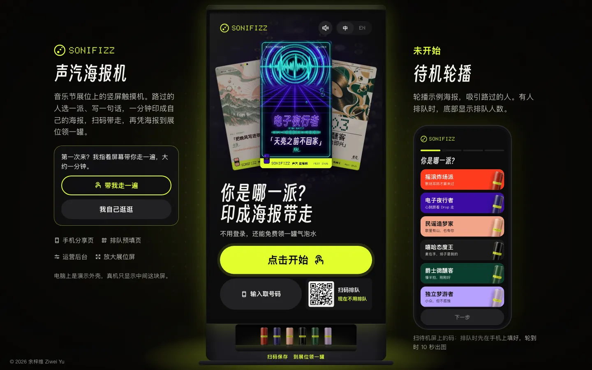
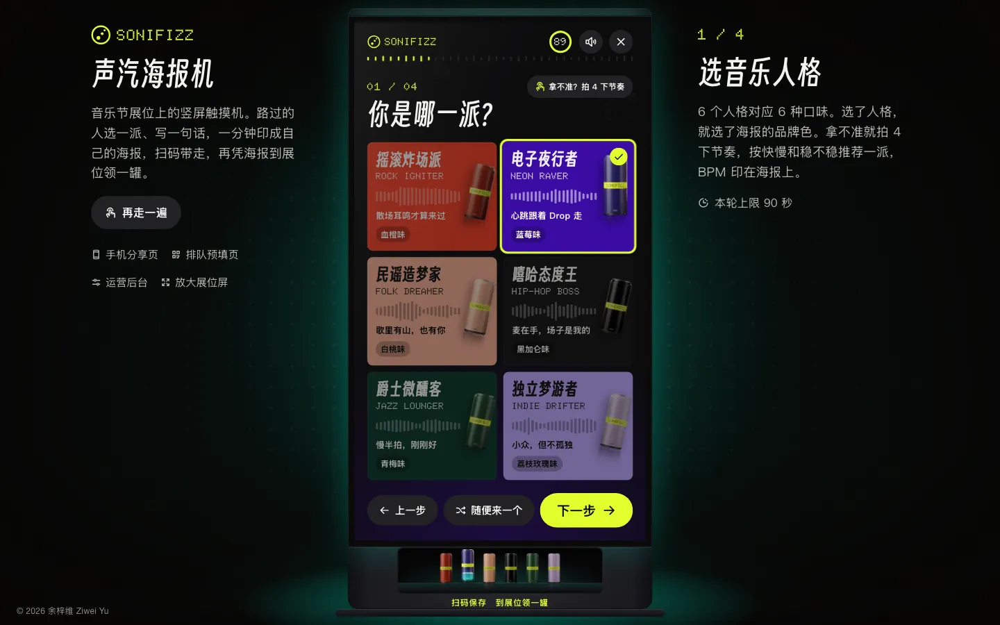
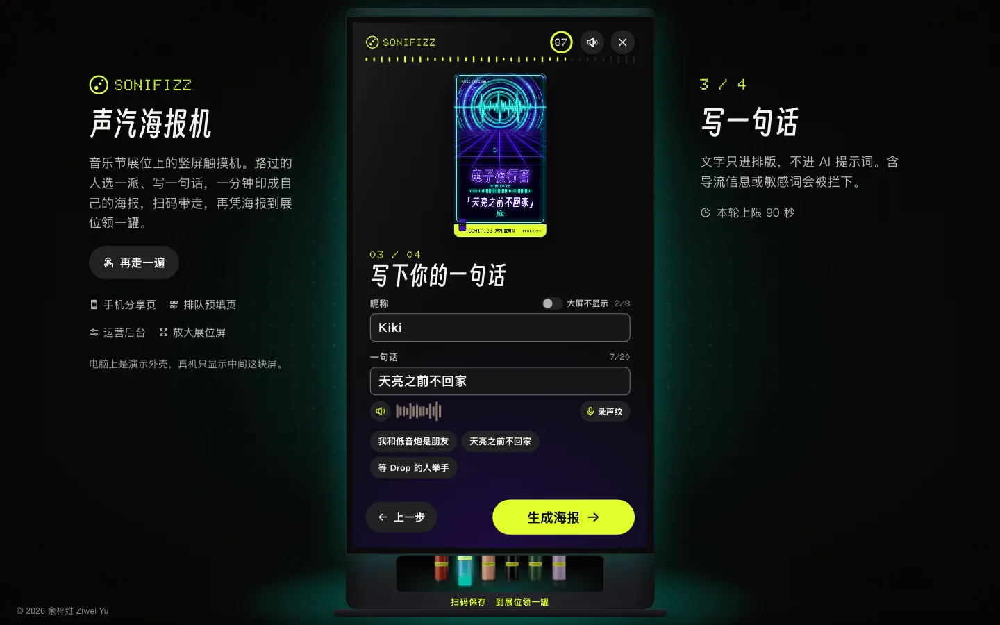
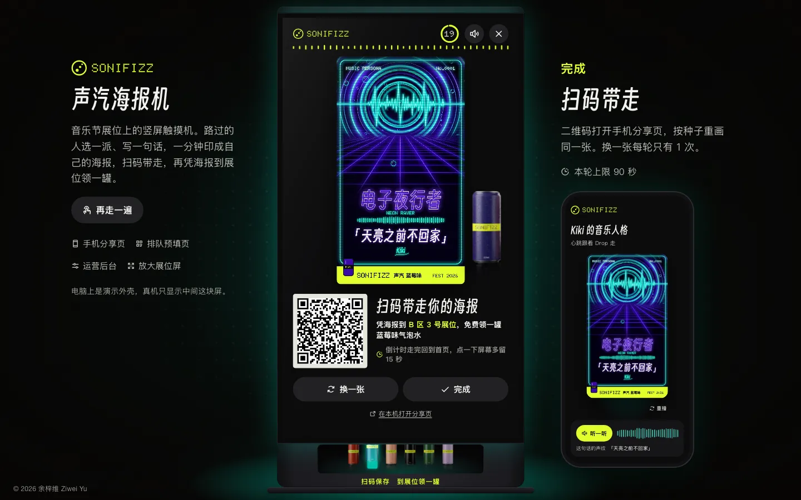
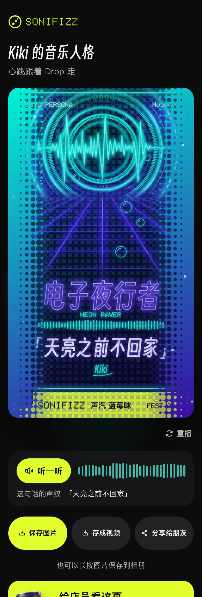
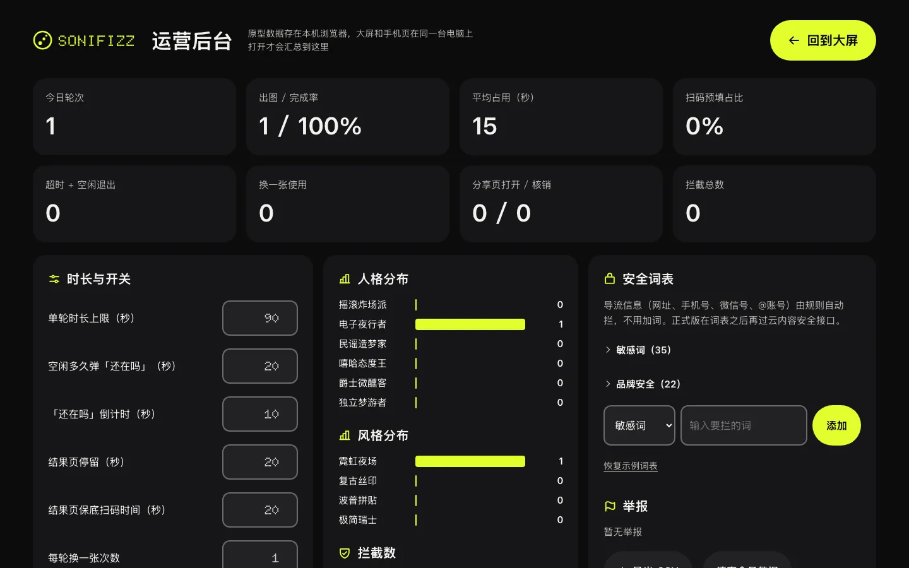

# SONIFIZZ Poster

A festival touch-kiosk poster prototype. At a music-festival booth, a visitor picks a persona, writes a line, and prints a poster to take away by QR code. SONIFIZZ is a fictional sparkling-water brand.

**Live demo:** https://ekko237.github.io/sonifizz-poster/

## Run locally

No install or build. Open `index.html` directly, or serve the folder so the pour animation can sample illustration colors:

```bash
python3 -m http.server 8000
```

Then open http://localhost:8000/ .

## License

Code is released under the [MIT License](LICENSE).

---

# SONIFIZZ 声汽海报机

音乐节展位上的竖屏触摸机网页原型：路过的人选一派、写一句话，一分钟印成自己的海报，扫码带走，再凭海报到展位领一罐气泡水。SONIFIZZ 是虚构的气泡水品牌。

**在线体验：** https://ekko237.github.io/sonifizz-poster/

<p>
  
</p>

## 怎么玩

1. **选一派。** 六种音乐人格对应六种口味。拿不准就拍 4 下节奏，按快慢和稳不稳推荐一派，BPM 印在海报上。
2. **选风格、写一句话。** 四种画风（霓虹夜场、复古丝印、波普拼贴、极简瑞士），写一个昵称和一句话。可以点麦克风念一遍，把自己的声音变成海报上的声纹。
3. **扫码带走。** 海报像一杯气水从下往上倒满，然后飞到结果页。手机扫码打开分享页，可以存图、存成视频、分享给朋友，凭页面上的核销码到展位领一罐。

<table>
  <tr>
    <td width="33%"></td>
    <td width="33%"></td>
    <td width="33%"></td>
  </tr>
</table>

## 四个页面

| 页面 | 文件 | 内容 |
|---|---|---|
| 大屏 | `index.html` | 触摸机本体。电脑上显示整台立式机和两侧说明，竖着的窗口或网址带 `?kiosk=1` 时只显示屏幕、铺满窗口 |
| 手机分享页 | `share.html` | 扫码后打开：重演倒汽、听这句话的声纹、存图存视频、核销领罐、邀请朋友 |
| 排队预填页 | `prefill.html` | 排队时在手机上先选好填好，拿一个 4 位取号码，轮到自己在大屏上输入 |
| 运营后台 | `admin.html` | 调整每轮时长、换一张次数等参数，看人格和风格分布、拦截数、举报，管理敏感词表。在大屏上连点 logo 5 次也能进入 |

<table>
  <tr>
    <td width="30%"></td>
    <td width="70%"></td>
  </tr>
</table>

## 设计要点

- **用户写的字只进排版。** 昵称和一句话最后作为文字叠在海报上，永远不进图像生成的提示词。导流信息（网址、手机号、微信号、账号）和敏感词在大屏、预填页、分享页三处用同一套规则拦下。
- **同一个种子画出同一张图。** 海报由人格、风格和随机种子决定，分享链接只带这几项参数，手机上按种子重画，不用上传图片。
- **海报底图是预先生成的素材池。** `assets/pool` 里六种人格乘四种风格，每组 4 张 AI 生成的底图，`assets/pool/s` 是对应的小图；海报上的文字、声纹和品牌条由 `js/poster.js` 在画布上现场绘制。
- **声音全部现场合成。** 六派各有招牌音色，生成时把这句话的声纹当成一小段旋律播出来，不带任何音频文件。
- **占用控制。** 每轮有时间上限，空闲会弹「还在吗」，结果页倒计时后自动回到首页，高峰模式下缩短时长并关掉换一张。
- **新手指引。** 第一次打开会问要不要带着走一遍，指哪点哪。
- **中英双语。** 大屏右上角切换语言，手机页面跟着走。

原型里的参数、统计、排队和核销记录都存在浏览器的 localStorage 里，大屏、手机页和后台在同一台电脑的同一个浏览器里打开才能互通。

## 本地运行

不需要安装和构建。下载以后直接双击 `index.html` 就能打开；用本地服务器打开效果更完整（生成动画里的网点能取到插画颜色）：

```bash
python3 -m http.server 8000
```

然后打开 http://localhost:8000/ 。

## 目录结构

```
index.html  share.html  prefill.html  admin.html  404.html
css/        base.css 公共样式、screen.css 大屏、mobile.css 手机页、admin.css 后台
js/
  config.js     人格、风格、默认参数、双语文案
  store.js      本地存储、分享链接编解码
  safety.js     内容安全规则和词表
  poster.js     海报绘制
  sound.js      声音合成
  scene.js      电脑演示的背景
  fit.js        外壳缩放
  pour.js       生成中的倒汽动画
  voicerec.js   念一遍录声纹
  screen.js     大屏的状态机和各屏逻辑
  tour.js       新手指引
  share.js  reveal.js  prefill.js  admin.js   各页面的脚本
assets/     品牌图（罐子、分享封面）和海报底图素材池
vendor/     字体、图标、二维码和中文断行库
docs/       README 用的截图
```

## 许可证

代码按 [MIT 许可证](LICENSE) 开源。

第三方素材按各自的许可证使用：Doto 字体（SIL OFL 1.1，见 `vendor/fonts/OFL.txt`）、得意黑 Smiley Sans（SIL OFL 1.1，见 `vendor/fonts/smiley/OFL.txt`）、Phosphor 图标（MIT）、qrcode-generator（MIT）、BudouX 中文断行模型（Apache-2.0，见 `vendor/budoux-zh.js` 文件头）。
